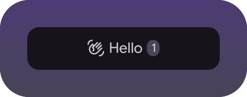
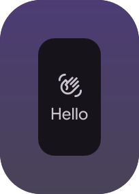
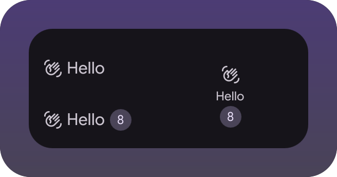
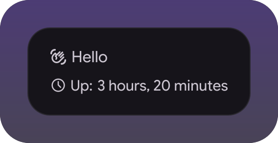

# Hello widget

The smallest widget for the [illogical-impulse extensions
fork](https://github.com/Berupor/dots-hyprland-extensions) that is still a real
one: an indicator that draws in both bars, a popup on hover, an option apiece for
the looks and the polling, a sibling type and a singleton that runs `uptime` for
the line the popup shows. Copy this repo to start your own.

| In the bar | In the vertical bar | Every state | The popup |
|---|---|---|---|
|  |  |  |  |

## What a widget is

A directory with a `Manifest.qml`, cloned into
`~/.config/illogical-impulse/widgets/<id>/`. The catalog scans that folder on
start, so no file of the shell needs editing.

| File | What it is there for |
|---|---|
| `Manifest.qml` | id, name, icon, versions, slots, options |
| `HelloIndicator.qml` | the view a slot points at |
| `HelloBadge.qml` | a sibling type, resolves with no import at all |
| `HelloPopup.qml` + `HelloDetails.qml` | the popup: frame and body, split because a window cannot be grabbed |
| `HelloState.qml` + `qmldir` | a singleton, which needs its `qmldir` line or its properties silently read as empty |
| `demo/` | scenes: the tests and the pictures, never loaded by the shell |
| `shots.txt` | what `widget-shots.sh` photographs for the README |

## The contract

- **Slots** are where the shell hangs your views: `barIndicator`,
  `barUtilButton`, `sidebarLeftTab`, `sidebarRightTab`, `backgroundWidget`,
  `regionAction`, and `catalogView` / `settingsView` for taking a settings screen
  over. Paths are relative to the widget directory.
- **Orientations** are what a bar slot draws for: `{"path": ..., "orientations":
  ["horizontal", "vertical"]}`, and the vertical bar hands the file
  `vertical: true`. One file covers both - `GridLayout { columns: vertical ? 1 :
  -1 }`, sized off `verticalBarWidth` instead of `barHeight`. List only the one
  you drew for and the other bar simply skips you; a bare path means horizontal.
- **Options** are a schema in the manifest, with defaults. The settings page
  draws them for you; read them back with `WidgetCatalog.option(id, key)`. A
  `settingsPage` is only needed when the generated form is not enough.
- **Dependencies** are binaries in `dependencies`. A widget missing one says so
  in the catalog instead of turning into a dead button. Whatever cannot be QML is
  a `Process` of your own plus that line - never something the catalog installs.
- **Popups** hang off the indicator as `StyledPopup`, a lazy window that lives
  while the bar item is hovered, so the indicator is a `MouseArea`. Keep the body
  in a file of its own: the probe can photograph an `Item`, not a window.
- **Versions**: bump `version` on every release, and keep `minShellVersion` at
  the contract you built against. The shell refuses a widget from the future.
- **Design system only**: `Appearance.*` for colors and fonts, `MaterialSymbol`,
  the widgets in `modules/common/widgets/`. Colors are generated from the
  wallpaper, so a hardcoded `#rrggbb` sticks out on everyone else's desktop.
  `design-lint.sh` fails the build over it.

The whole contract is written down in the shell's
`modules/widgets/WidgetManifest.qml`.

## Working on it

Clone into the widgets folder, enable it in Settings → Widgets, and let the
fork's toolkit do the rest. It renders your widget in a throwaway shell instance,
so nothing touches the session you are working in:

```sh
tests/widget-probe.sh hello barIndicator -x ~/.config/illogical-impulse/widgets/hello
tests/qml-cases.sh    -x ~/.config/illogical-impulse/widgets/hello
tests/widget-shots.sh -x ~/.config/illogical-impulse/widgets/hello
```

The vertical bar is the same probe with the property set and its own host:
`-p vertical=true -H vbar -g 46x110`.

`git config core.hooksPath .githooks` runs the cases and redraws the shots on
push, so the README never shows a widget you no longer have.

## Install

Settings → Widgets → Install a widget, paste:

```
https://github.com/Berupor/ii-widget-hello.git
```

GPL-3.0, same as the shell it plugs into.
